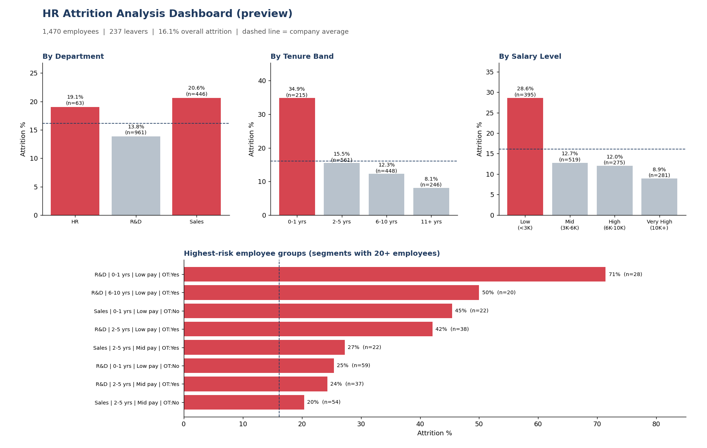

# HR Attrition Analysis Dashboard

An end-to-end HR analytics project that shows **employee turnover by department, tenure band and salary level**, and identifies the **highest-risk employee groups**.

**Tools:** Power BI (Power Query, DAX) | Python (pandas, matplotlib) | Kaggle dataset
**Dataset:** [IBM HR Analytics Employee Attrition & Performance](https://www.kaggle.com/datasets/pavansubhasht/ibm-hr-analytics-attrition-dataset) - 1,470 employees, 35 columns (fictional data created by IBM data scientists).



## Project structure
```
hr_attrition/
|-- data/
|   |-- WA_Fn-UseC_-HR-Employee-Attrition.csv   raw Kaggle data
|   `-- processed/                              generated by analysis.py
|       |-- hr_clean.csv                        cleaned data with bands
|       |-- attrition_by_*.csv                  summary tables
|       `-- high_risk_groups.csv                ranked risk segments
|-- python/analysis.py                          cleaning + analysis + preview chart
|-- powerbi/
|   |-- 01_power_query.m                        data load & transformation (M)
|   |-- 02_dax_measures.dax                     KPIs, risk logic, High Risk table
|   |-- 03_build_guide.md                       step-by-step dashboard build
|   `-- theme.json                              colour theme
|-- output/dashboard_preview.png
`-- requirements.txt
```

## How to run
**1. Python analysis**
```bash
pip install -r requirements.txt
python python/analysis.py
```
**2. Power BI dashboard** - open `powerbi/03_build_guide.md` and follow the steps (about 30-45 min).
The `.pbix` file is built in Power BI Desktop, which is why this repo ships the exact M, DAX and layout instructions instead of a binary file.

## Method
- **Cleaning:** removed 3 constant columns (`EmployeeCount`, `Over18`, `StandardHours`); confirmed no missing values and unique `EmployeeNumber`.
- **Attrited flag:** 1 if `Attrition = Yes`, so average = attrition rate.
- **Tenure bands** (YearsAtCompany): 0-1, 2-5, 6-10, 11+ years.
- **Salary bands** (MonthlyIncome): Low <3K, Mid 3-6K, High 6-10K, Very High 10K+.
- **High-risk groups:** Department x Tenure x Salary x Overtime segments with **at least 20 employees**, ranked by attrition rate and compared to the company average.

## Key findings (company average: 16.1% - 237 of 1,470)
| Dimension | Highest | Lowest |
|---|---|---|
| Department | Sales **20.6%** | R&D 13.8% |
| Tenure | 0-1 yrs **34.9%** | 11+ yrs 8.1% |
| Salary | Low (<3K) **28.6%** | Very High 8.9% |
| Overtime | Yes **30.5%** | No 10.4% |

**Highest-risk groups**
1. R&D, 0-1 yrs, low pay, working overtime - **71.4%** (20 of 28 left, 4.4x average)
2. R&D, 6-10 yrs, low pay, working overtime - **50.0%** (10 of 20)
3. Sales, 0-1 yrs, low pay - **45.5%** (10 of 22)
4. R&D, 2-5 yrs, low pay, working overtime - **42.1%** (16 of 38)

**Takeaway:** attrition is driven mainly by *low pay + overtime + early tenure*. New hires on low salaries who work overtime are the most at risk, and Sales Representatives (39.8%) and employees under 25 (39.2%) are also well above average.

## Recommendations
- Review pay for sub-3K roles, especially in the first two years.
- Cap or compensate overtime in R&D low-pay roles.
- Strengthen onboarding and 90-day / 1-year check-ins for new hires.
- Investigate Sales Representative workload and incentives.

## Limitations
- Single snapshot, no leave dates, so no time trends.
- Fictional IBM dataset; findings show *association*, not proven causes.
- Some segments are small (20-60 people), so treat rates as indicative.
